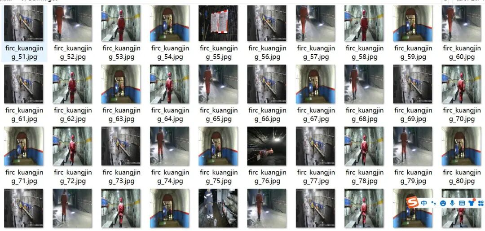
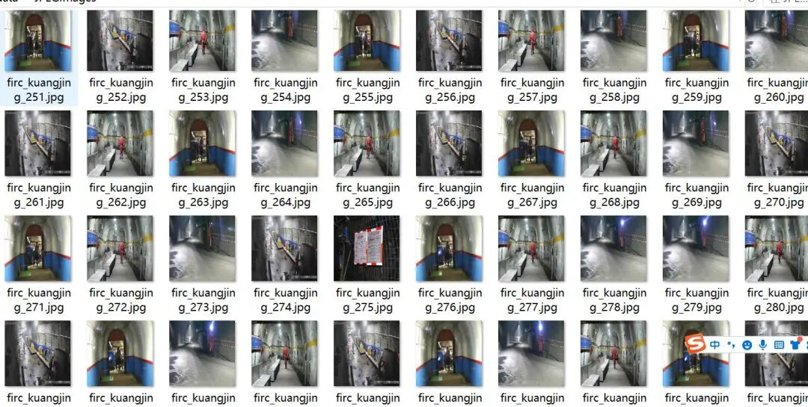
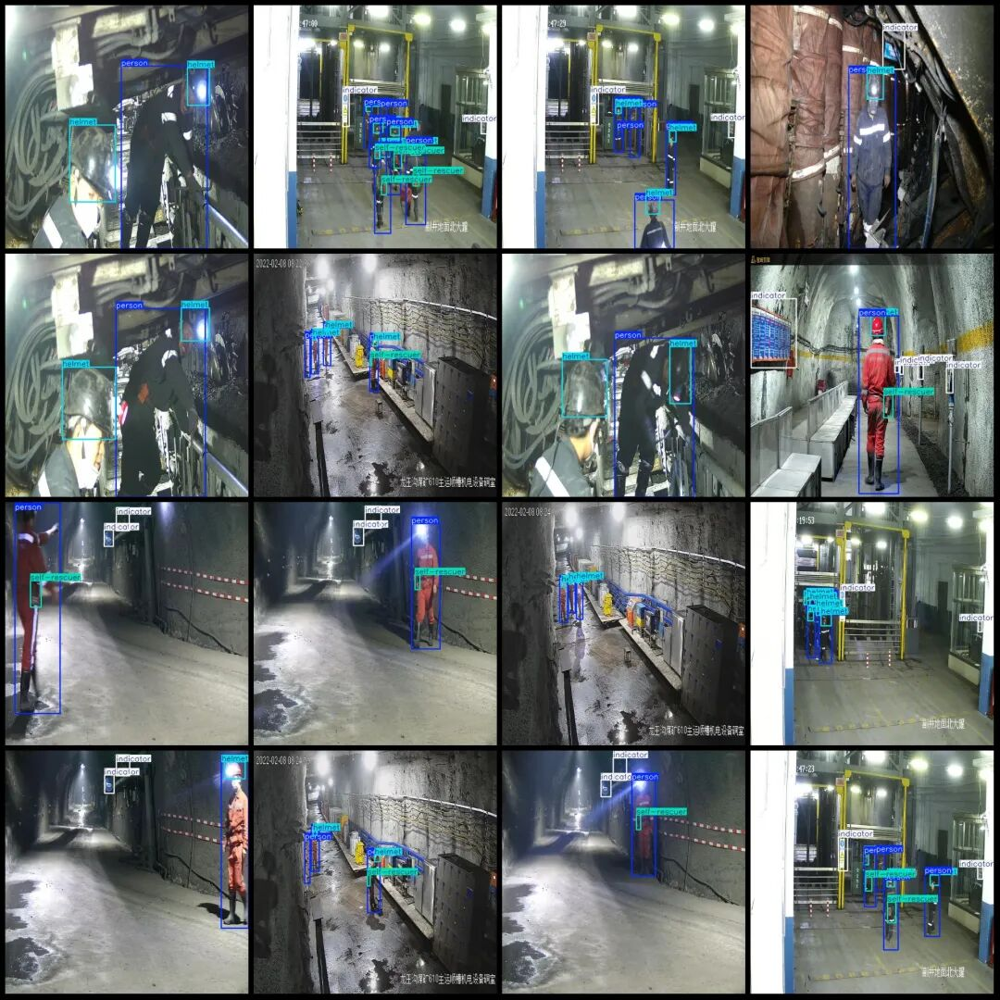
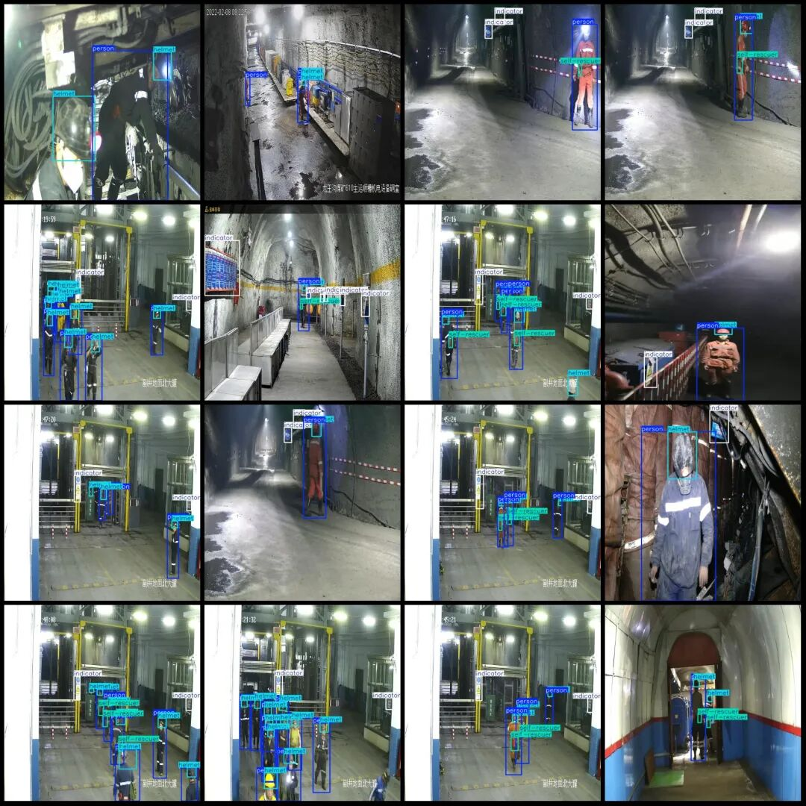

# Smart Mine Safety Helmet Personnel Light Indicator Self-Rescue Device Detection Data Set VOC+YOLO format 4369 images 4 categories

Dataset format: Pascal VOC format + YOLO format (txt file without split path, only containing jpg images and corresponding VOC format xml files and yolo format txt files)

Number of images (number of jpg files): 4369

Number of annotations (number of xml files): 4369

Number of annotations (number of txt files): 4369

Labeling category count: 4

Label category names (Note: the order of yolo format categories does not correspond to this, but is based on the labels folder's classes.txt): ["helmet", "indicator", "person", "self-rescuer"]

Number of boxes labeled in each category:

Helmet (Safety Cap) Frame Count = 10652

Indicator (Indicator/Light) Frame Count = 6185

Person (person) Frames = 10341

Self-rescuer (self-rescue device) frame count = 4522

Total frame count: 31700

Image resolution: 640x640

Using labelImg:

Annotation rules: Draw a rectangle around the category.

Important Notice: No

Special : This dataset does not guarantee the accuracy of the trained models or weight files.

Image Preview:

Annotation example:

## Payment

Here is a pay link on Stripe ( https://buy.stripe.com/3cs8yP7sY87d0vu9AB ). Please contact me lonlonago@foxmail.com after funding $89, and I will send you a complete data files , thank you!

